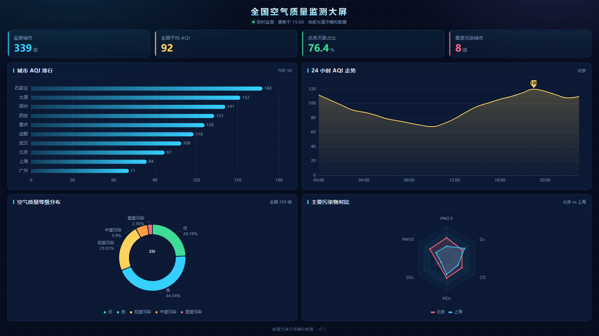

# 全国空气质量监测大屏

一个用 Vue3 + ECharts 搭的数据可视化大屏，v0.1 阶段使用模拟数据，后续逐步接入真实数据。

> 这是我转前端路上的主力作品集项目，从 v0.1 开始逐版本迭代。



## 技术栈

| 用途 | 选型 |
|---|---|
| 框架 | Vue 3（组合式 API，`<script setup>`） |
| 构建 | Vite 6 |
| 图表 | ECharts 5 |
| 样式 | 原生 CSS（CSS 变量 + Grid 布局） |
| 部署 | Vercel（待接入） |

## 怎么跑起来

### 方式一：双击脚本（推荐）

直接双击 **`dev.cmd`**，会自动装依赖、启动服务并打开浏览器。

- 关闭那个黑色窗口 = 停止服务
- 打包生产版本：双击 **`build.cmd`**，产物在 `dist\`

### 方式二：命令行

```bash
npm install     # 首次需要
npm run dev     # 开发，默认 http://localhost:5173
npm run build   # 打包，产物在 dist/
npm run preview # 本地预览打包结果
```

### 关于 Node 环境

本项目在 `..\tools\node`（即 `C:\WEBJOB\tools\node`）下自带了一份 Node
（v26.13.1 + npm 11.20），**不需要在系统里另装 Node**。`dev.cmd` / `build.cmd`
会自动把它加进 PATH。

如果要在命令行里手动跑 npm，先执行（PowerShell）：

```powershell
$env:PATH = "C:\WEBJOB\tools\node;$env:PATH"
npm.cmd run dev
```

> ⚠️ PowerShell 默认禁止运行 `npm.ps1`，所以命令行里要写 `npm.cmd` 而不是 `npm`。
> 用 `dev.cmd` 就不会碰到这个问题。

## 目录结构

```
dashboard/
├── dev.cmd                       # 一键启动（含依赖安装）
├── build.cmd                     # 一键打包
├── index.html
├── vite.config.js
├── package.json
├── docs/
│   └── preview.png               # README 用截图
└── src/
    ├── main.js                   # 应用入口
    ├── App.vue                   # 大屏整体布局：标题 / 数字卡 / 图表网格
    ├── style.css                 # 全局主题变量（改这里换配色）
    ├── data/
    │   ├── mock.js               # 演示数据（以后换成真实接口）
    │   └── theme.js              # 图表公共配置：配色、坐标轴、tooltip
    ├── composables/
    │   └── useChart.js           # 图表生命周期封装：初始化 / 自适应 / 销毁
    └── components/
        ├── ChartCard.vue         # 图表卡片外壳（标题 + 内容插槽）
        ├── StatCard.vue          # 顶部数字卡
        ├── BarChart.vue          # 城市 AQI 排行（横向条形图）
        ├── LineChart.vue         # 24 小时走势（面积折线图）
        ├── PieChart.vue          # 等级分布（环形图）
        └── RadarChart.vue        # 污染物对比（雷达图）
```

## 三个关键设计

### 1. 图表生命周期收在 `useChart` 里

每个图表组件都要做三件事：挂载后初始化、窗口变化时自适应、卸载前销毁。如果每个组件各抄一遍，改起来很痛苦。

所以抽成了一个 composable：

```js
const { el } = useChart(() => ({ /* option */ }))
```

模板里只要写 `<div ref="el" class="chart"></div>`。

### 2. 数据与视图分离

所有数据放在 `src/data/mock.js`，组件只负责渲染。**以后换成真实接口，组件代码一行都不用改。**

### 3. 公共样式抽到 `theme.js`

配色、坐标轴、tooltip 的样式统一维护，四个图表视觉一致，换主题只改一个文件。

## 想改点什么？从这里下手

| 想做的事 | 改哪里 |
|---|---|
| 换整体配色 | `src/style.css` 顶部的 CSS 变量 |
| 换图表配色 | `src/data/theme.js` 的 `palette` |
| 改数据 | `src/data/mock.js` |
| 改大屏布局（几行几列） | `src/App.vue` 里 `.grid` 的 `grid-template-*` |
| 加一个新图表 | 复制 `BarChart.vue` 改名成 `XxxChart.vue`，在 `App.vue` 里加一个 `<ChartCard>` 包起来 |

## 开发进度

- [x] 整体布局（标题栏 / 数字卡 / 2×2 图表网格）
- [x] 暗色科技风主题
- [x] 四个图表：条形 / 折线 / 环形 / 雷达
- [x] 图表随窗口自适应
- [x] 移动端单列布局
- [ ] **中国地图（下一步）**
- [ ] 接入真实数据
- [ ] 部署到 Vercel
- [ ] 接入访问统计

## 下一步计划

| 版本 | 内容 |
|---|---|
| **v0.5** | 加中国地图（ECharts `geo` + `china.json`）、接入真实数据接口 |
| **v1.0** | 数据采集自动化（Python 定时抓取）、10+ 图表、筛选联动、性能优化 |
| **v1.5** | 实时推送（SSE/WebSocket）、暗色/亮色切换、开源成模板 |

## 补充说明

- 当前数据为**模拟数据**，仅用于演示视觉效果，不代表真实空气质量
- `echarts` 目前是全量引入（打包后约 1.1MB / gzip 373KB），v1.0 阶段会改成按需引入以减小体积
- `npm install` 时关于 `esbuild@0.25.12` 的 install-scripts 警告可以忽略：esbuild 的平台二进制已随依赖一起装好，不影响构建

## 许可

MIT
